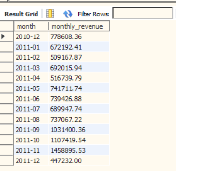
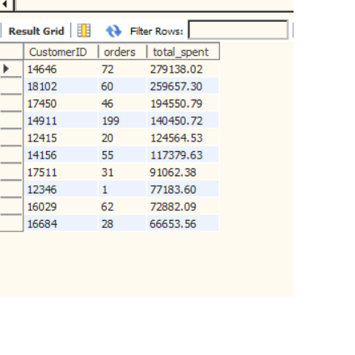
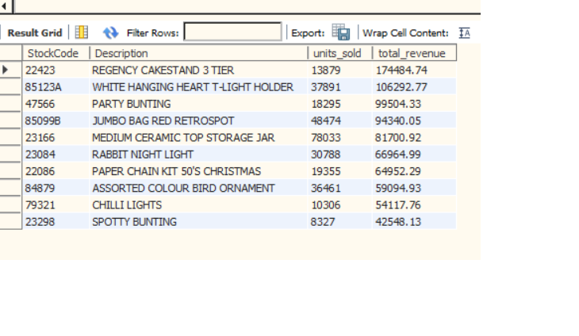
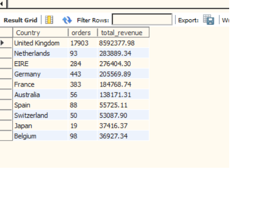
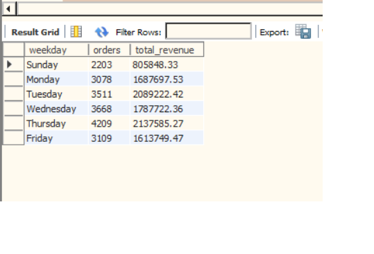

# Online Retail SQL Analysis

Customer and revenue analysis of 5.4 lakh retail transactions using MySQL.

## What this project does
I wrote SQL queries to answer business questions from an online retail dataset.

## Queries and results
1. *Monthly revenue*: revenue trend month by month
2. *Top customers*: customers who spent the most
3. *Top products*: best-selling products
4. *Revenue by country*: which countries bring the most revenue
5. *Revenue by weekday*: which days of the week sell the most

## Result screenshots

### Monthly revenue

### Top customers

### Top products

### Revenue by country

### Revenue by weekday

## Files
- online_retail_sql_analysis.sql: all SQL queries
- 01 to 05 PNG files: screenshots of query results

## Tools
MySQL
